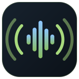
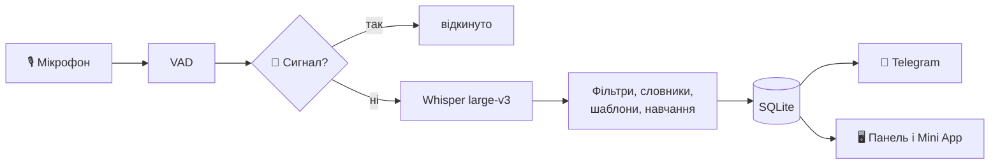

<div align="center">



# Radio 345

**Локальне розпізнавання радіоефіру з миттєвими сповіщеннями в Telegram**

[](https://github.com/jackrv/radio/actions/workflows/tests.yml)
[](https://github.com/jackrv/radio/actions/workflows/miniapp-pages.yml)
<br>


[Вікі](docs/README.md) · [Встановлення](docs/install.md) · [Панель](docs/panel.md) · [Розмітка](docs/archive.md) · [Лабораторія](docs/lab.md)

</div>

---

Radio 345 слухає рацію через мікрофон Mac, розпізнає мовлення **повністю
локально** і за кілька секунд надсилає кожному учаснику голосове з текстом —
з позивними, командами й «кому / від» у шапці. Оператор виправляє тексти в
Mini App чи локальній панелі, і система вчиться на цих правках, **не вигадуючи
чисел і позивних**.



## ✨ Можливості

| | |
| --- | --- |
| 🎙️ **Розпізнавання на пристрої** | MLX Whisper large-v3 на Apple Silicon, WebRTC VAD, підказка зі словників |
| 📚 **Словники ефіру** | позивні з дозволеними номерами, команди, коди доби, аліаси — зміни без перезапуску |
| 🛡️ **Безпечні виправлення** | шаблони зворотів і цілих фраз, числа ніколи не підміняються |
| 🧠 **Навчання за правками** | правки оператора стають перевіреними словесними правилами |
| 🔔 **Фільтр сигналів** | звуки сповіщень телефонів відкидаються ще до Whisper |
| 💬 **Telegram** | особисті режими, ролі, доступ через `/start`, оновлення й видалення копій у всіх |
| 🖥️ **Локальна панель** | розмітка архіву, підказки «Потребує уваги», якість по днях, експерименти |
| 🩺 **Надійність** | самовідновлення після сну Mac, щоденні копії бази, діагностика сесій |

## 🚀 Швидкий старт

```bash
python3.12 -m venv .venv
.venv/bin/python -m pip install -r requirements-dev.txt
cp .env.example .env                              # токен бота й чат першого адміністратора
cp dictionaries.example.txt dictionaries.txt      # ваші позивні й команди
.venv/bin/python start_radio345.py                # усе: API, ngrok, приймач, панель
```

Лаунчер сам запропонує імпортувати словники й зареєструвати адміністратора.
Докладно — [Встановлення й перший запуск](docs/install.md).

## 🕹️ Щоденна робота

| Команда | Дія |
| --- | --- |
| `start_radio345.py --status` | що запущено |
| `start_radio345.py --restart` | перезапустити служби |
| `start_radio345.py --receiver-stop` / `--receiver-start` | лише приймач (панель і Mini App працюють) |
| `start_radio345.py --stop` | зупинити все |
| `python -m api.local_dashboard --open` | відкрити панель (127.0.0.1:8766) |
| `diagnose_radio345.py --verify-backup --network` | перевірка без зупинки |

## 📖 Документація

| | |
| --- | --- |
| 🚀 [Встановлення](docs/install.md) | `.env`, формат словників, перший адміністратор |
| ⚙️ [Запуск і служби](docs/launcher.md) | лаунчер, консоль, журнали, сон Mac |
| 🎙️ [Розпізнавання](docs/recognition.md) | етапи конвеєра, безпека чисел, формат передач |
| 📚 [Словники й фільтри](docs/dictionaries.md) | коди доби, аліаси, шум, шаблони фраз |
| 🧠 [Навчання](docs/learning.md) | які правки стають правилами |
| 🎧 [Аудіоархів](docs/archive.md) | розмітка, клавіші, метрики, зберігання |
| 🔔 [Фільтр сигналів](docs/signal-filter.md) | зразки, пороги, перевірка на розмітці |
| 🖥️ [Локальна панель](docs/panel.md) | розділи, «Потребує уваги», доступ |
| 💬 [Telegram і Mini App](docs/telegram.md) | режими, ролі, правки, видалення |
| 💾 [Дані й копії](docs/data.md) | резервні копії, відновлення, скидання |
| 🩺 [Діагностика](docs/diagnostics.md) | метрики, затримки, історія сесій |
| 🧪 [Лабораторія](docs/lab.md) | офлайн-порівняння й результати дослідів |

## 🗂️ Структура

```text
radio.py, config.py       приймач і базові параметри
start_radio345.py         лаунчер служб
manage_database.py        імпорт, експорт, скидання й відновлення бази
diagnose_radio345.py      перевірка без зупинки приймача
core/                     ядро без бази: аудіо, VAD, Whisper, позивні, аналіз тексту, шаблони, фільтр сигналів
services/                 SQLite і все, що з нею працює: словники, списки, навчання, Telegram, архів, підказки
services/management/      керування з панелі й Mini App: словники, навчання, користувачі, налаштування
api/                      FastAPI для Mini App; local_dashboard.py — вхід і безпека панелі
api/panel/                ендпоінти панелі за розділами (огляд, архів, розпізнавання, сигнали, люди, система)
local_admin/              сторінка панелі; js/ — скрипт за розділами (сервер склеює їх в один /admin.js)
miniapp/                  Mini App (HTML/CSS/JS без збирання, GitHub Pages)
tools/                    лабораторія: asr_lab, text_replay
tests/                    pytest і node-тести на тимчасових даних
docs/                     вікі
```

## 🧪 Тести

```bash
.venv/bin/python -m pytest -q
node --test tests/*.cjs
```

Тести працюють на тимчасових базах, синтетичному аудіо й підміненому Telegram —
без моделей і мікрофона; робочу `events.db` відкрити не можуть. GitHub Actions
запускає їх на `macos-latest`.

## 🔒 Приватність

`.env`, `dictionaries.txt`, `events.db`, журнали, копії, аудіо, діагностика й
каталоги `.local-*` **ніколи не потрапляють у Git**. У репозиторії — лише код,
документація й шаблони з вигаданими назвами. Детальніше — [Дані й копії](docs/data.md).
