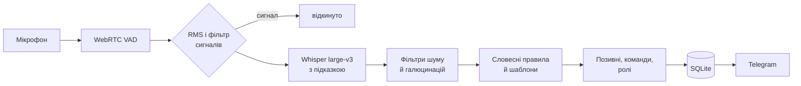

# 🎙️ Як працює розпізнавання

[← Вікі](README.md)



## Етапи

1. **Аудіо.** PortAudio → WebRTC VAD → обмежена черга сегментів.
2. **Відсів до моделі.** Тихі сегменти (RMS) і [звуки сповіщень](signal-filter.md).
3. **Whisper** `mlx-community/whisper-large-v3-mlx` з підказкою: фрази списку
   «Підказка Whisper» + назви всіх словників за абеткою.
   Якщо модель зациклилася («Грозу, Грозу, Грозу…») і тексту не лишилося — **другий
   шанс**: той самий сегмент ще раз без підказки (вмикається в панелі, «Whisper»).
4. **Відсів тексту.** Порожній текст, довге сміття, фрази-галюцинації, короткий
   шум, переписаний перелік назв словника (`dictionary_echo`), одиночний позивний
   без змісту.
5. **Виправлення написання** (`core/text_analysis.py`):
   - навчені [словесні правила](learning.md);
   - `canonical_text` — слово перед точним номером словника пишеться як у словнику;
   - `template_text` — м’які шаблони зворотів, склеювання «на 109» → «Набат 109»,
     скорочення зациклень, [шаблони цілих фраз](dictionaries.md#шаблони-цілих-фраз).
6. **Розбір:** позивні, команди, «Кому / Від».
7. **Подія й сповіщення** за правами, режимом і cooldown.

Виправлений текст — основний (подія, журнал, Mini App, сповіщення). Почуте Whisper
зберігається окремо в `raw_text`; від нього рахується правка оператора.

**Qwen2.5-3B** вимкнено в налаштуваннях розпізнавання панелі: на 277 записах
вона запропонувала 106 змін, прийнято 13, кращих і гірших — 0, а коштувала
медіанно 1,6 с на сегмент. Увімкнути можна там само.

## Підказка Whisper і «луна» словника

На тиші large-v3 іноді переписує шматок підказки: «42 42, злива, береза, вишня…».
`strip_dictionary_echo` (`core/analyzer.py`) прибирає низку з трьох і більше назв
без номерів підряд за абеткою. Якщо лишилися тільки назви й цифри — сегмент
відкидається (`dictionary_echo`). Назва з номером до переліку не належить.
На нічних прогонах правило не зачепило жодного правильного збігу й прибрало
96 хибних.

## Чи відповідає текст активності звуку

Для дослідження вигадок на тиші є readonly інструмент:
`.venv/bin/python -m tools.audio_text_audit` (окрема картка — `--record <id>`).
Він порівнює число токенів із повною тривалістю, енергетичною активністю та
періодичністю звуку. Тексту й аудіо у JSON немає; `speech` і `unclear`
показуються окремо як ризик втрати мовлення, а не як успішно прибраний шум.

**Це не автоматичний фільтр.** На 2923 еталонах енергетичні варіанти зачіпають
справжнє мовлення. Піки/паузи на спектрограмі не є межами слів; тихі звуки й
цифрові групи роблять просте порівняння ненадійним. Указаний власником приклад
уже був відсіяний `dictionary_echo`, хоча сирий Whisper зберігся в архіві.
[Числа й обмеження](reports/2026-11-21-audio-text-consistency.md).
MIN_RMS, VAD, модель і робочі параметри декодування цим аналізом не змінено.

## Безпека чисел

- `canonical_text` і `template_text` **ніколи не змінюють цифри**.
  Лише оформлення: чотири цифри поспіль пишуться парами, як їх вимовляють
  («4862» → «48 62»; рік перед «році» не чіпається).
- Крапку в кінці фрази, яку ставить Whisper, прибрано (в еталонах її немає); крапки між
  передачами й «…» лишаються.
- Рівно два «прийом» поспіль — «прийнято, прийом»: так Whisper майже завжди чує цей зворот
  (18.11.2026: в еталонах подвоєне «прийом» — у 2 фразах із 362, у тексті програми — 17 разів;
  6 фраз краще, 1 гірше). Три й більше поспіль не змінюються.
- Після уточнення власника перед канонізацією та виділенням метаданих працює
  `core.dictionary_blocks`: точна назва команди, повна довжина коду й незмінена
  повна група дають право відновити єдиний словниковий блок. Допустимий код
  має перевагу; неоднозначність і відсутність опорної групи забороняють заміну.
  Старий пошук «схожого номера» (`near_number`) не повернуто.
- Для позивного можливе лише контекстне виправлення конкретного недопустимого
  номера за ≥3 незалежними одностайними еталонами; цільовий номер має бути
  дозволений поточним словником. Значення зі слів у цифри переводиться без зміни.
  Докладні [умови](dictionaries.md#словник-бере-участь-у-виправленні-тексту),
  [докази й обмеження](reports/2026-11-21-dictionary-blocks.md).
- **Напівкод.** Команда, від коду якої почуто половину («злива 42» при коді
  «42 42»), показується в шапці як «злива 42 42 (почуто «42»)».
- Код доби з часу запису може підтвердити лише пунктуацію: кому між його двома парами
  замінюємо пробілом; правило те саме, що в редакторі. Цифри не змінюються.
  Підказка про схожий, але інший код лишається ручною — автоматичної заміни немає.
- Не повертаємо нечітку заміну цілої фрази чи автоматичне «найближче» число.

## Відмінювання

Давальні форми «Клену», «Кленові» не переписуються на «Клен» (захищені
закінчення `-у`/`-ові` після незміненої основи). Почуту форму лишайте в еталоні.
Цей захист діє і в словесній корекції, і під час застосування шаблону цілої
фрази: наступний шар не прибирає вже збережене закінчення.

## Формат передач

К — адресат, О — відправник, Т — текст. Будь-яка частина може бути пропущена:

```text
К, К, я О, Т, прийом      К, Т, прийом      О, Т      Т, прийом
```

«П, прийнято, прийом» може називати і адресата, і відправника. Пропуски не
роблять фразу шумом. Підтверджені звороти: перевірка звʼязку, на звʼязок/на
звʼязку, чую й розбираю, до роботи приступив, роботу закінчив, посилку отримав,
прийнято/прийняв, цифрові групи, «повторіть, голос не пройшов».

**Ролі** (`split_roles`): є «я» — позивні до нього адресати, перший після —
відправник; без «я» два різні позивні на початку (у другого номер) — адресат і
відправник; один позивний одразу з цифрами чи «посилку отримав» — відправник;
інакше всі — адресати. На розмітці: «кому» 50/50, «від» 56/57.
